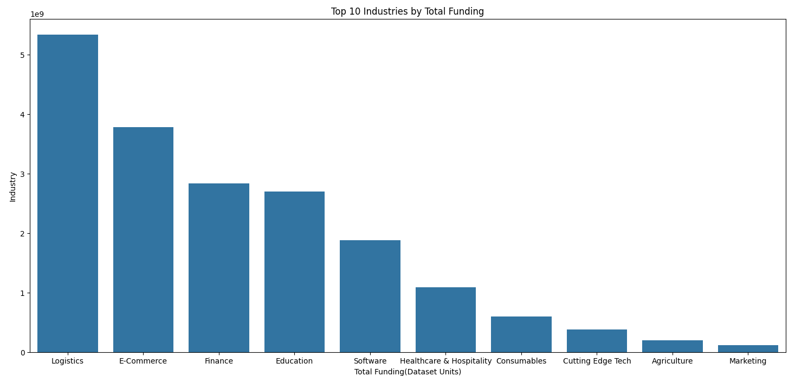
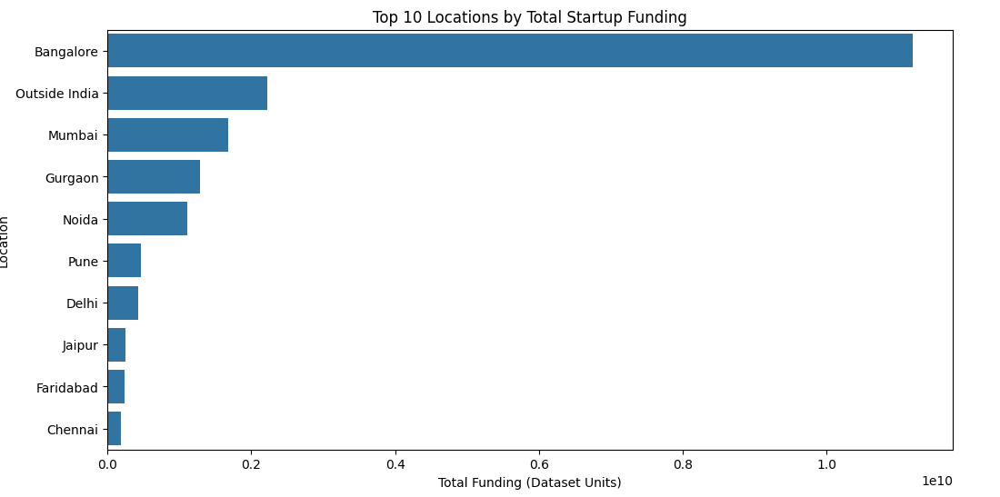
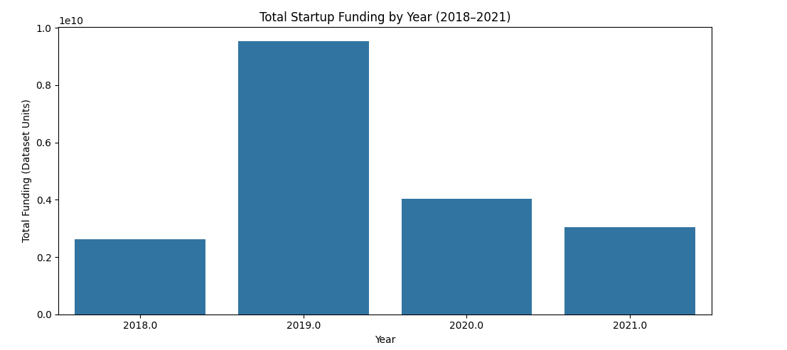
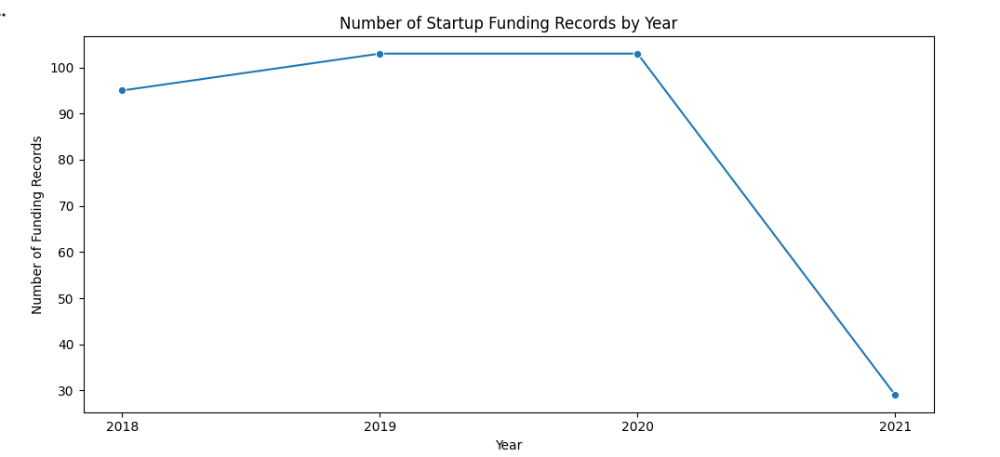
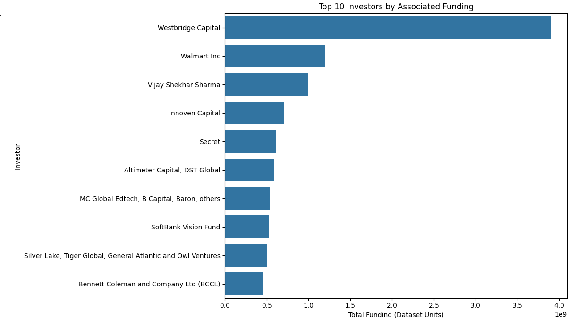
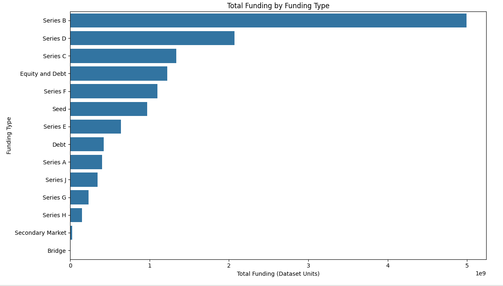

# Indian Startup Funding Analysis (2018–2021)


## 1. Project Overview

This project explores Indian startup funding patterns using Python. It analyses funding across industries, locations, years, startups, investors and funding types to identify trends and generate business insights.

## 2. Project Objectives

- Identify industries receiving the highest funding.
- Compare funding activity across different locations.
- Examine yearly funding trends.
- Identify startups receiving significant funding.
- Analyse investor participation.
- Understand funding distribution across funding stages.

## 3. Tools & Technologies

- Python
- Pandas
- NumPy
- Matplotlib
- Seaborn
- Google Colab

## 4. Dataset Information

The project uses an Indian startup funding dataset containing:

- Startup name
- Funding date
- Industry
- Location
- Investor
- Funding type
- Funding amount

**Final cleaned dataset:** 331 records.

**Original dataset:** 550 records.

Dataset source: [Kaggle – Indian Startup Funding Data](https://www.kaggle.com/datasets/manomayjamble/startup-funding-clean)

*Note: The currency of the funding amounts has not yet been independently verified.*

## 5. Data Cleaning & Preparation

The following steps were performed:

1. Removed unnecessary index column.
2. Removed duplicate records.
3. Standardised text columns by removing unnecessary whitespace.
4. Converted the Date column into datetime format.
5. Extracted the Year column from dates.
6. Identified one missing date.
7. Checked missing values and invalid funding amounts.
8. Investigated outliers using the IQR method.
9. Retained genuine high-value funding transactions rather than automatically deleting outliers.

## 6. Exploratory Data Analysis & Visualisations

### 6.1 Industry-wise Funding Analysis

Examined total funding, average funding, median funding and funding record counts across industries.



### 6.2 Location-wise Funding Analysis

Compared funding across startup locations and identified the leading funding hubs.



### 6.3 Year-wise Funding Analysis

Analysed annual funding totals and the number of funding records from 2018 to 2021.



### 6.4 Startup-wise Funding Analysis

Identified startups with the highest cumulative recorded funding.



### 6.5 Investor-wise Funding Analysis

Examined investor names associated with the highest funding amounts.



### 6.6 Funding Type Analysis

Compared funding totals across different funding stages and types.



## 7. Key Business Findings

- **Industry:** Logistics recorded the highest total funding in the dataset.
- **Location:** Bangalore led in total funding and funding record count.
- **Year:** 2019 recorded the highest annual funding.
- **Startup:** Rapido Bike Taxi had the highest recorded startup funding.
- **Investor:** Westbridge Capital was associated with the largest investor-wise funding record.
- **Funding Type:** Series B recorded the highest total funding among identified funding types.

## 8. Business Recommendations

- Investigate industries attracting substantial funding while considering the influence of individual large transactions.
- Examine Bangalore's funding activity and the transactions influencing funding averages in other locations.
- Investigate the factors behind the 2019 funding peak.
- Compare startup funding totals with the number of funding rounds.
- Standardise investor information to improve investor-level analysis.
- Improve funding-stage classification to reduce the number of Unknown records.

## 9. Limitations

- One record contains a missing date.
- Several funding records have an Unknown funding type.
- Multiple investors may appear together in a single investor field.
- Currency information requires verification.
- The dataset may not represent the complete Indian startup ecosystem.

## 10. Conclusion

This project demonstrates how exploratory data analysis can uncover patterns in startup funding across industries, locations, years, startups, investors and funding types.

Using Python and data visualisation techniques, the project converts raw funding records into meaningful business insights that can support further investigation and data-driven decision-making.

## 11. Project Structure

```text
Indian-startup-funding-analysis/
│
├── charts/
│   ├── distribution_start_funding.png
│   ├── location_startup_funding.png
│   ├── yearly_funding.png
│   ├── total_startup_funding.png
│   ├── investors_associated_funding.png
│   └── total_funding_by_funding_type.png
│
├── Indian_Startup_Funding_Analysis.ipynb
├── startup_clean.csv
└── README.md
```

---

**Developed using Python | Google Colab | Exploratory Data Analysis**
